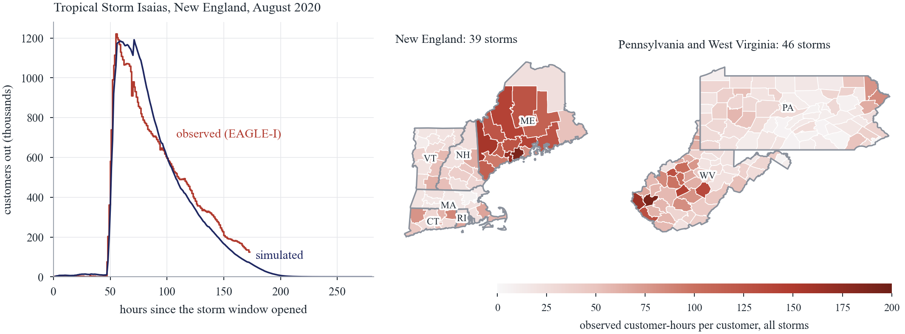
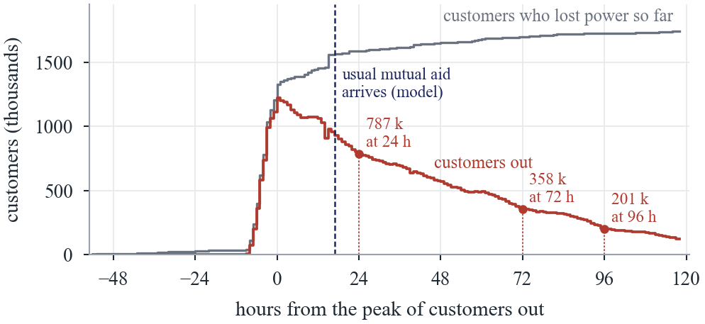
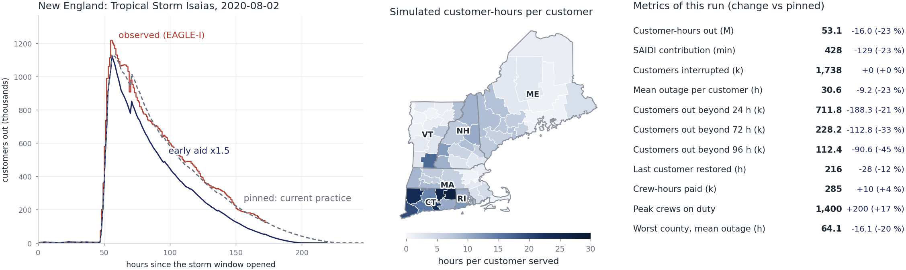
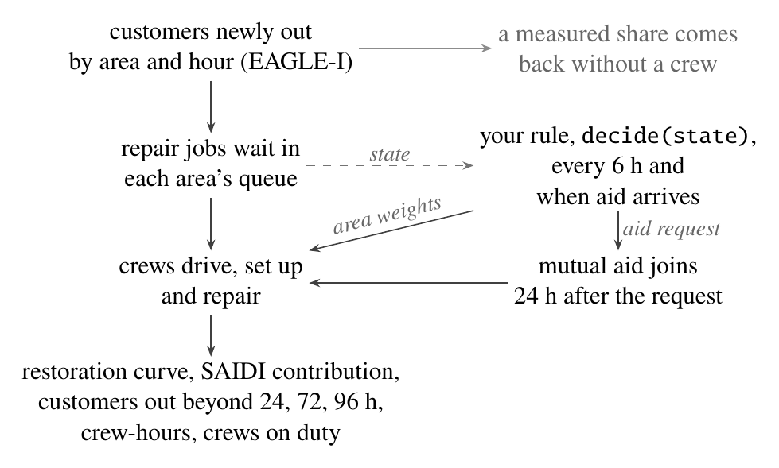
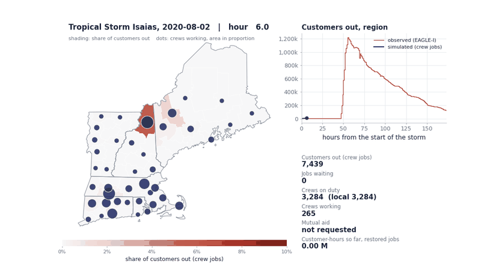
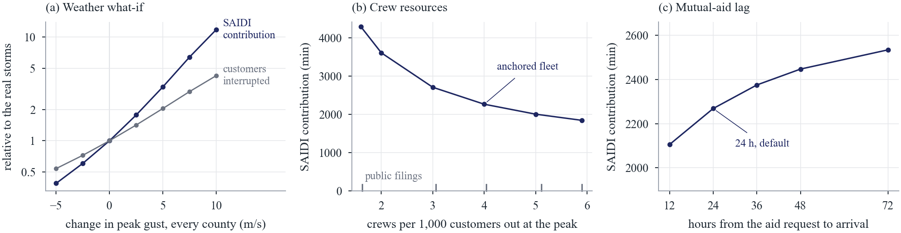
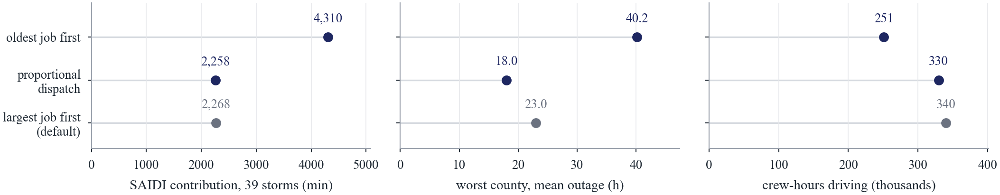
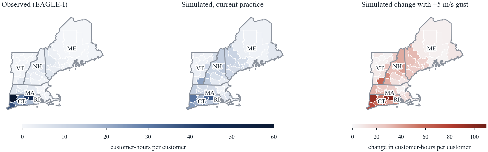
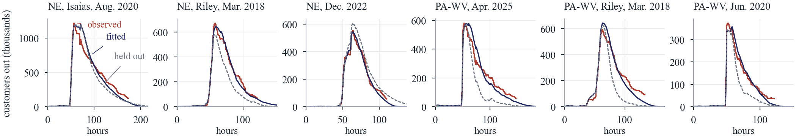
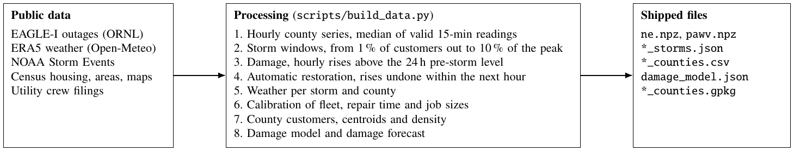

<div align="center">

# StormCrews

**An open simulator of distribution restoration after storms, built from public outage records.**

[](https://www.python.org/)
[](LICENSE)
[](DATA_LICENSE.md)
[](tests)
[](https://mybinder.org/v2/gh/abrahambohorquez/stormcrews/main?labpath=notebooks%2Fexplore.ipynb)
[](https://colab.research.google.com/github/abrahambohorquez/stormcrews/blob/main/notebooks/explore.ipynb)

</div>

StormCrews replays 85 real storms (2018 to 2025) in 189 counties of New England, Pennsylvania and West Virginia, hour
by hour, and simulates the repair crews, the mutual aid and the restoration rules that bring customers back. Every run
reports what a distribution engineer tracks: the storm's contribution to SAIDI, customers out beyond 24, 72 and 96
hours, crew-hours and the crews on duty.

<p align="center">
  
  <br><em>Tropical Storm Isaias as EAGLE-I recorded it (red) and as StormCrews simulates it (navy), next to the 85
  storms of the two regions.</em>
</p>

**Who it is for.** Distribution planners asking how fleet size, mutual-aid timing or a restoration rule would have
changed the reliability indices of past storms; regulators checking restoration standards and long-outage counts;
researchers who need a common, reproducible set of real storms to compare rules on; students who want to read every
equation of a restoration model.

**What it is not for.** Dispatching or routing one utility's crews in a live storm, switching sequences, feeder
reconfiguration, power flow, voltage or protection, or estimated times of restoration for single customers. StormCrews
works at county level with one pooled fleet per region; an outage management system or a network model answers those
questions.

## The problem

<p align="center"></p>
<p align="center"><em>Isaias in New England, August 2020: a quarter of the customers who lost power did so after the
peak, and 201 thousand were still out four days later. The storm added 552 minutes to the region's SAIDI.</em></p>

After a storm the control room sees customers out by area, not the faults behind them. Damage keeps arriving for
hours, crews lose time driving, and crews from other utilities arrive a day or more after the request. How many crews,
sent where, serving which jobs first and asking for help when, decides how long customers wait. StormCrews lets you
change those decisions on storms that really happened and read the result in reliability terms.

## Contents

- [Install](#install) and [a 30-second start](#a-30-second-start)
- [Explore without code](#explore-without-code)
- [How a run works](#how-a-run-works), [examples](#examples) and [what a run reports](#what-a-run-reports)
- [Writing your own rule](#writing-your-own-rule)
- [Calibrations](#calibrations), [what-if weather](#what-if-weather) and [synthetic storms](#synthetic-storms)
- [Validation](#validation)
- [Data and licenses](#data-and-licenses)
- [Reproducing the paper](#reproducing-the-paper)
- [Limitations](#limitations), [citing](#citing), [authors](#authors), [license](#license) and
  [contributing](#contributing)

## Install

StormCrews needs Python 3.10 or later. Pick one of three ways.

```bash
# 1. Straight from GitHub
pip install git+https://github.com/abrahambohorquez/stormcrews

# 2. From a clone, editable, with the optional maps and notebook packages
git clone https://github.com/abrahambohorquez/stormcrews.git
cd stormcrews
pip install -e ".[maps,notebook]"

# 3. From a clone, with everything needed to run the tests
pip install -e ".[dev]"
pytest                      # 55 tests, about a minute
```

The storms, counties and boundaries ship inside the package (about 2 MB), so nothing else is downloaded. Maps need
`geopandas` (the `maps` extra); without it the plots fall back to county centroids.

## A 30-second start

```python
from stormcrews import Simulator
from stormcrews.rules import CurrentPractice

sim = Simulator("new_england", calibration="anchored")
r = sim.run(CurrentPractice(), storm="isaias", seed=1)
m = r.metrics
print(r.storm.name)
print(f"SAIDI contribution  {m['saidi_min']:,.0f} min")
print(f"customer-hours      {m['customer_hours'] / 1e6:,.1f} million")
print(f"out beyond 72 h     {m['over_72h'] / 1e3:,.0f} thousand")
print(f"crews on duty       {m['crews_max']:,.0f}")
print(f"last customer back  {m['restoration_end_h']:,.0f} h")
```

```
Tropical Storm Isaias, 2020-08-02
SAIDI contribution  564 min
customer-hours      70.0 million
out beyond 72 h     284 thousand
crews on duty       4,926
last customer back  277 h
```

The same from the command line:

```bash
stormcrews storms --region ne                                  # the storms and their ids
stormcrews whatif --storm isaias --gust +5 --rule current      # the real storm and a stronger one
stormcrews synthetic --center 41.8 -72.7 --peak 38 --radius 120 --template isaias --rule current
```

## Explore without code

`notebooks/explore.ipynb` puts the simulator behind sliders and menus. Open it on
[Binder](https://mybinder.org/v2/gh/abrahambohorquez/stormcrews/main?labpath=notebooks%2Fexplore.ipynb) or
[Colab](https://colab.research.google.com/github/abrahambohorquez/stormcrews/blob/main/notebooks/explore.ipynb)
without installing anything, or locally with `pip install -e ".[notebook]"` and `jupyter lab notebooks/explore.ipynb`.

<p align="center">
  
  <br><em>Isaias under early mutual aid, with current practice pinned as the baseline (gray) and the metrics card.</em>
</p>

How to use it:

1. **Pick a storm** in the first menu (both regions, Isaias by default) and a **calibration** (see
   [Calibrations](#calibrations)).
2. **Change the weather** if you want a what-if: gust change (m/s), rain factor, soil moisture, footprint shift and
   scale, duration factor and the share restored without a crew. At their neutral values the real
   storm is replayed and the observed EAGLE-I curve is drawn in red.
3. **Set the operations**: local fleet factor, mutual aid on or off, aid lag (h) and size, the job order inside a
   county and the hours between decisions.
4. **Pick a rule** from the reference rules and a **seed**. The run starts on each change, or on *Run* when automatic
   runs are off.
5. **Press *Pin as baseline*** to keep the current run in gray, then change anything: the card shows each metric and
   its change against the pinned run.

The second tab builds a **synthetic storm** from a gust field (center, peak gust, radius) on the timing of a real
template storm. The third runs **two rules side by side** on the same storm and seed.

What the outputs mean: the curve is customers out per hour across the region; the map is customer-hours per customer
served in each county; the card gives the [metrics below](#what-a-run-reports).

## How a run works

<p align="center"></p>

A run needs four things.

- **A storm.** The hourly rises of customers out in each county, taken from EAGLE-I, replay the real damage as it
  arrived. A measured share (9 % to 31 % depending on the storm) comes back within the hour without a crew
  (reclosers, remote and quick manual switching). The rest becomes repair jobs of about 35 customers each, with
  unequal sizes.
- **A scenario.** The region, the calibration, the fleet, mutual aid and its lag, what-if weather and the job order.
  Four ship in `stormcrews/config/`; every key is documented in [docs/configuration.md](docs/configuration.md).
- **A rule.** At each decision point, every 6 hours and when aid arrives, it reads the state and returns where crews
  should be and whether to ask for aid.
- **A seed.** Job sizes, arrival times inside the hour and repair times are random. Every rule sees the same draws for
  a given seed (common random numbers), so differences between rules are paired.

Crews drive between county centroids at 60 km/h, spend half an hour setting up and repair a job in a lognormal time.
Inside a county the job with most customers goes first by default. Mutual aid requested with multiplier *m* brings
0.5 × local fleet × *m* crews 24 hours later; if the rule has not asked by the time 1 % of customers are out, the usual
request goes out. A free crew stays in its county while the county is below its target and otherwise moves to the
county short of most crews (or, with proportional dispatch, furthest below its target in proportion).

<p align="center">
  
  <br><em>Isaias replayed under current practice: share of customers out by county, crews at work (dots) and the
  regional curve, simulated (navy) against observed (red).</em>
</p>

`python example.py` walks through one storm, two reference rules, a rule of your own and a step-by-step session.

## Examples

The paper's illustrations, each one command (see [Reproducing the paper](#reproducing-the-paper)), on the 39 New
England storms with the anchored calibration and three seeds.

<p align="center"></p>
<p align="center"><em>Stronger gusts add outage minutes faster than interruptions (left); more crews help with
diminishing returns over the range utilities reported (middle); a longer mutual-aid lag raises SAIDI step by
step (right).</em></p>

<p align="center"></p>
<p align="center"><em>Proportional dispatch keeps the SAIDI contribution and shortens the worst county's outage;
serving the oldest job first nearly doubles SAIDI even though crews drive less.</em></p>

## What a run reports

`result.metrics` is a dict. The ones a distribution engineer reads first:

| Key | Unit | Meaning |
|---|---|---|
| `customer_hours` | customer-hours | Σ customers × hours out, crew jobs and automatic restorations |
| `saidi_min` | minutes | The storm's contribution to SAIDI (IEEE Std 1366, major event days included): customer-minutes over customers served |
| `caidi_h` | hours | Mean outage per customer interrupted, the event's CAIDI |
| `customers_interrupted` | customers | Customer interruptions of the storm |
| `over_24h`, `over_72h`, `over_96h` | customers | Customers out longer than one, three and four days |
| `restoration_end_h` | hours | When the last customer is back, from the start of the storm window |
| `worst_county_h` | hours | Mean outage in the worst county hit by the storm |
| `crews_max` | crews | Crews on duty once every aid crew has joined |
| `local_crew_hours`, `aid_crew_hours` | crew-hours | Paid hours: local crews from the start of the storm, aid crews from the request, to the end of restoration |
| `busy_crew_hours`, `travel_crew_hours` | crew-hours | Hours crews spent on jobs (travel, setup, repair) and driving between counties |

`result.curve()` gives customers out at the end of every hour, comparable with `result.storm.observed`.

To run many rules, scenarios, storms and seeds:

```python
from stormcrews import run_experiment
from stormcrews.rules import REFERENCE

exp = run_experiment(REFERENCE, ["new_england", "stress_test"], seeds=range(3), workers=4)
exp.table                         # one row per scenario, rule, storm and seed
exp.summary()                     # totals over storms, mean over seeds
exp.compare("current practice")   # paired differences with bootstrap intervals over storms
```

## Writing your own rule

A rule is any object with `decide(state)`, or a plain function of the state.

```python
class LongestWaitFirst:
    name = "longest wait first"
    execution = {"dispatch": "relative"}        # optional: how the plan is carried out

    def decide(self, s):
        weights = s.out * (1 + s.wait_h / 24)    # one non-negative number per county
        aid = 1.0 if s.t >= 12 and not s.aid_requested else 0.0
        return weights, aid

Simulator("new_england").run(LongestWaitFirst(), storm=10, seed=1)
```

**What `decide` receives.** A `State`. Arrays have one value per county, in the order of `state.counties`. Nothing is
normalized: every field is in physical units, and a rule that wants shares divides by `s.customers` or `s.crews`.

| Field | Unit | Meaning |
|---|---|---|
| `t` | h | Time since the storm window opened |
| `out` | customers | Out and waiting for a crew or under repair |
| `waiting_jobs` | jobs | Repair jobs in the county queue |
| `working` | crews | Working or driving to a job in the county |
| `wait_h` | h | Wait of the county's oldest queued job |
| `arrived` | customers | Customers whose outage has appeared so far (crew jobs) |
| `restored` | customers | Customers restored by crews so far |
| `crews`, `local_crews` | crews | On duty including aid that has arrived; the local fleet |
| `aid_requested_at`, `aid_crews` | h, crews | When aid was requested (None if not yet) and how many crews it brings |
| `aid_requested` | true/false | Whether aid has been requested |
| `crews_at` | crews | Crews standing in each county, working, driving or idle |
| `forecast` | customers | Interruptions the damage model expects in each county for this storm |
| `customers` | customers | Customers served |
| `counties` | table | FIPS, name, state, customers, latitude, longitude, customers per square mile |
| `dist_km` | km | Distances between county centroids |
| `repair_mean_h`, `setup_h` | h | Calibrated mean repair time and setup time per job |
| `queue` | customers, h | With `execution = {"queue_view": True}`: the size and arrival hour of every waiting job |
| `customer_hours_so_far` | customer-hours | Customer-hours of the jobs restored so far |
| `storm`, `scenario`, `seed` | | The storm (id, name, metadata such as `peak_hour`), the scenario and the seed |

**What it returns.** Non-negative weights, one per county, optionally with an aid multiplier: `weights`,
`(weights, aid)`, `{"weights": ..., "aid": ...}` or `Decision(weights, aid, aid_at)`. The engine scales the weights
to crew targets. Only the first aid request of a storm counts; `aid = 1` asks for half the local fleet.

**How it is carried out.** The optional `execution` dict sets `job_order` (`largest`, `oldest`, `guard`, `sweep`),
`dispatch` (`absolute`, `relative`), `replan_after_aid` and `queue_view`.

**Step by step.** `s = sim.start(storm, seed)` returns a session stopped at the first decision; `s.state` is what a
rule would see and `s.step(decision)` moves to the next one, until `s.done`.

The reference rules are in `stormcrews.rules.REFERENCE`: current practice (crews follow customers out), forecast
weighting (crews also follow the damage the forecast still expects) and early mutual aid.

## Calibrations

Each storm has three numbers behind it, the local fleet, the mean repair time and the spread of job sizes, chosen so
that current practice reproduces what was observed.

| Calibration | How the three numbers are set | Median fleet, NE / PA-WV |
|---|---|---|
| `shape` (default) | Fleet fitted to the observed customer-hours, then repair time and spread to the hours from the peak to one half and one tenth of it | 272 / 424 |
| `equal` | Equal jobs and 3-hour repairs; only the fleet is fitted | 960 / 1,152 |
| `anchored` | Fleet set so that local plus usual aid crews equal 4.0 per 1,000 customers out at the peak, the median of public utility filings; repair time fitted to customer-hours, spread to the shape | 342 / 302 |
| `anchored_low`, `anchored_high` | The same at the lowest and highest ratio of the filings | |

```python
Simulator("new_england", calibration="anchored")
```

The anchored calibration is the one to use when crew counts matter, since its fleet follows crew numbers utilities
reported (1.6 to 5.9 line crews per 1,000 customers out at the peak in five filings).

## What-if weather

A `what_if` block changes the damage of a real storm through a damage model fitted on all 8,225 storm-county cells of
both regions (peak gust, rain, soil moisture and customer density, with a fixed effect per storm). Each
county gets a multiplier on its hourly rises, capped at the largest interruptions per customer ever observed. At
neutral values the real storm is replayed bit for bit.

```python
sim = Simulator("new_england", calibration="anchored", what_if={"gust_change": 5})
sim.run(CurrentPractice(), storm="isaias", seed=1).metrics["saidi_min"]
```

<p align="center"></p>
<p align="center"><em>Isaias by county: observed customer-hours per customer, the same simulated, and the simulated
change with 5 m/s stronger gusts.</em></p>

The knobs (gust, rain, soil moisture, customer growth, footprint shift and scale, duration, automation share,
coefficient draws) are listed with units in [docs/configuration.md](docs/configuration.md#what_if). The model is
associational and extrapolates beyond the observed weather when pushed far.

## Synthetic storms

A storm that never happened: a gust field over the region, on the timing and crews of a real template storm.

```python
import stormcrews as sc

R = sc.region("ne")
storm = sc.synthetic_storm(R, sc.gust_field(R, (41.8, -72.7), 38, 120), 10)   # center, peak gust m/s, radius km, template
sc.Simulator("new_england").run(sc.rules.CurrentPractice(), storm, seed=1).metrics["saidi_min"]
```

## Validation

The calibration fits customer-hours and the two decay times of each storm, so its fit is in sample. The regional peak
is not a target and checks it: it comes out at 0.88 to 0.94 of the observed peak (median over storms, any
calibration). Predicting every storm with repair parameters taken from the other storms of its region (leave one storm
out), customer-hours miss by 34 % in New England and 29 % in Pennsylvania and West Virginia at the median. StormCrews
replays observed storms closely and predicts an unseen one roughly.

<p align="center"></p>
<p align="center"><em>Observed EAGLE-I customers out (red), the anchored fit (navy) and the held-out prediction (gray,
dashed) for six storms.</em></p>

`python scripts/calibration_check.py` compares every storm under every calibration;
`python paper_gtdla/experiments.py holdout` runs the leave-one-storm-out check.

## Data and licenses

Everything that ships is built from public records (`scripts/build_data.py` documents each step).

<p align="center"></p>

| Source | Provides | Resolution | License |
|---|---|---|---|
| EAGLE-I, Oak Ridge National Laboratory | Customers out per county | County, 15 minutes | CC BY 4.0 |
| ERA5 via Open-Meteo | Peak gust, precipitation, soil moisture | 0.25°, hourly | CC BY 4.0 |
| US Census Bureau | Housing units (customers), land area, centroids, boundaries | County | Public domain |
| NOAA Storm Events Database | Event type of each storm | Event | Public domain |
| Utility and regulator filings | Line crews at the peak (anchored calibration) | Utility, storm | Public documents |

**EAGLE-I attribution.** Outage data from EAGLE-I, Oak Ridge National Laboratory (Brelsford et al., *Scientific Data*
11, 271, 2024, [doi:10.1038/s41597-024-03095-5](https://doi.org/10.1038/s41597-024-03095-5); data
[doi:10.6084/m9.figshare.24237376.v4](https://doi.org/10.6084/m9.figshare.24237376.v4), version 4), under CC BY 4.0. The 15-minute
county records were aggregated to hourly values, storm windows were detected, and damage was measured above each
county's pre-storm baseline. **Neither Oak Ridge National Laboratory nor the US Department of Energy endorses this
work.** Full attributions and terms, including ERA5, Open-Meteo, the Census and NOAA, are in
[DATA_LICENSE.md](DATA_LICENSE.md), which also ships inside the package.

## Reproducing the paper

`paper_gtdla/` holds the five-page paper for IEEE PES GT&D Latin America 2027. Every number in it comes from
`paper_gtdla/macros.tex`, written by a script, and every figure from a script. With at most four processes:

| Output | Command |
|---|---|
| Runs: gust what-if, crews and aid lag, rules, customers per job, trigger, leave-one-storm-out | `python paper_gtdla/experiments.py all` (or one of `gust`, `crews`, `rules`, `perjob`, `trigger`, `holdout`) |
| Fig. 1, Isaias as recorded | `python paper_gtdla/make_figures.py problem` |
| Fig. 2, the restoration loop | drawn in TikZ in `paper_gtdla/main.tex` |
| Fig. 3, validation | `python paper_gtdla/make_figures.py validation` |
| Fig. 4, Isaias maps | `python paper_gtdla/make_figures.py isaias_maps` |
| Fig. 5, illustrations | `python paper_gtdla/make_figures.py demos` |
| Every number in the text and tables | `python paper_gtdla/make_macros.py` |
| The calibration summary it reads | `python scripts/calibration_check.py` |
| The PDF | `cd paper_gtdla && pdflatex main && bibtex main && pdflatex main && pdflatex main` |
| Every image of this README | `python scripts/make_figures.py` |

`evaluator.py` compares the reference rules under the shipped scenarios with paired intervals, and `whatif_sweep.py`
sweeps a weather what-if over every storm; their results are in `results/`.

## Limitations

- One pooled crew fleet per region; utilities restore their own territories, so the split of long outages between
  utilities is not reproduced (in Isaias, Connecticut's are spread over the region).
- Counties are the unit. There is no feeder topology, switching or power flow, and crews drive between centroids.
- Damage is replayed from the records; the what-if model is associational.
- The calibration is per storm and in sample; out of sample a storm's customer-hours are predicted only roughly, and
  the regional peak comes out low.
- 35 customers per repair job is an assumption. Relative effects change little with it; long-tail counts and
  crew-hours change more (see the paper's sensitivity).
- Early-aid rules read the hour of the peak from the data, which amounts to a perfect timing forecast.

## Citing

Please cite the software and the EAGLE-I data. `CITATION.cff` has the details; in BibTeX:

```bibtex
@software{stormcrews,
  author  = {Boh{\'o}rquez G{\'o}mez, Abraham Jes{\'u}s and Murillo Aristiz{\'a}bal, Juan Jos{\'e} and
             Tabares Pozos, Alejandra and Cort{\'e}s Sanabria, Pablo Jos{\'e}},
  title   = {{StormCrews}: an open simulator of distribution restoration after storms},
  year    = {2026},
  version = {0.3.0},
  url     = {https://github.com/abrahambohorquez/stormcrews}
}
```

## Authors

Abraham Jesús Bohórquez Gómez, Juan José Murillo Aristizábal, Alejandra Tabares Pozos and Pablo José Cortés Sanabria,
Department of Industrial Engineering, Universidad de los Andes, Bogotá, Colombia.

## License

The code is under the [MIT license](LICENSE). The derived data in `stormcrews/data` are CC BY 4.0 with the
attributions in [DATA_LICENSE.md](DATA_LICENSE.md).

## Contributing

Issues and pull requests are welcome: new regions, utility service territories, rules and metrics. Run `pytest` before
opening a pull request. `tests/test_engine.py` compares the engine with the research code it came from and is skipped
where that code is not available. Changes are listed in
[CHANGELOG.md](CHANGELOG.md).
